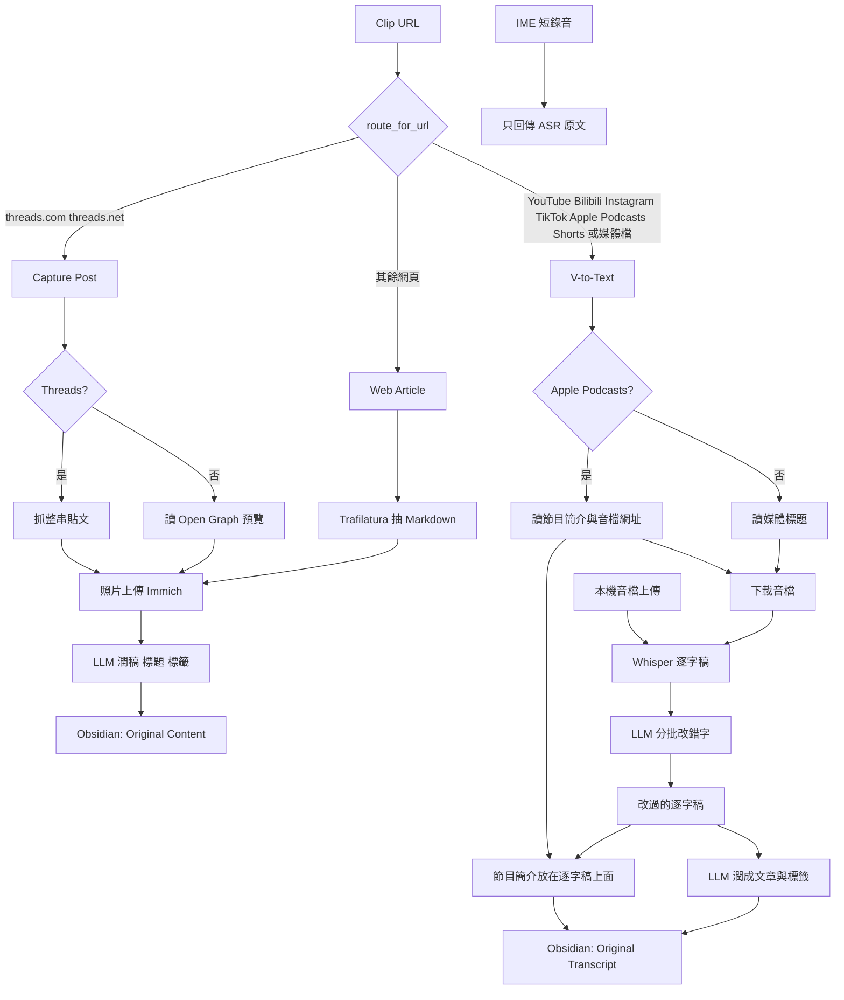

# Media 執行路徑

入口是 `POST /api/clip-requests` 的 `known_sources.route_for_url`（`source/webui/app/main.py`、`source/webui/app/known_sources.py`）。另外兩條不經過這個分流：本機上傳的語音，以及 IME 短錄音。

三條筆記路徑的差別：

- **Web Article**：Trafilatura 抽出正文與圖片，圖片進 Immich。原文進 Original Content，再潤稿、下標題、貼標籤。
- **Capture Post**：Threads 走整串貼文；其他貼文網址只讀 Open Graph。圖片同樣進 Immich，筆記區塊與文章相同。Instagram、TikTok 不走這裡，它們被歸到 V-to-Text。
- **V-to-Text**：下載後做 Whisper。錯字修正只改辨識片段，節目簡介不送進這一步。Apple Podcasts 的簡介排在 Original Transcript 上方。潤稿用的是改過的逐字稿。本機上傳走同一條 Whisper 之後的路徑，只是沒有下載與節目簡介。
- **IME**：`/api/transcribe/ime` 停在原始辨識文字，不改錯字，也不寫 Obsidian 筆記。
